  

#  ✨ SANJANAA V ✨

### AI/ML Engineer in the Making | B.Tech IT Student | Problem Solver

---

## 🌷 About Me

Hey there! I'm **Sanjanaa**, a second-year Information Technology undergraduate at **Sri Sairam Engineering College**, passionate about building intelligent systems and solving real-world problems through technology.

- 🎓 B.Tech Information Technology | 2025–2029
- 🤖 Interested in Artificial Intelligence, Machine Learning and Data Science.
- 💻 Exploring backend engineering, distributed systems and scalable applications.
- 🧠 Strengthening my problem-solving skills through Data Structures and Algorithms.
- 🔬 I enjoy experimenting with ideas and turning them into practical projects.
- 🎯 Currently looking for AI/ML, Data Science and Software Engineering internship opportunities.

**My goal:** Build technology that solves meaningful problems and create an impact through engineering.

---

## 🛠️ Tech Stack

### Programming Languages

### AI / Machine Learning & Data Science

### Backend & Tools

**Also familiar with:** REST APIs, Data Preprocessing, Feature Engineering, Model Evaluation, Text Classification, OOP and DSA.

---

## 🚀 Featured Projects

### 1. ORION³ — Pre-payment Scam Risk Scoring System

An intelligent scam-risk scoring system designed to identify suspicious digital payment activity **before a user completes a transaction**.

- Developed an ALLOW / WARN / BLOCK decision system with understandable risk explanations.
- Combined transaction behaviour, receiver-network signals and suspicious message patterns.
- Built a FastAPI service with a measured p95 response time of 27 ms.
- Evaluated models using chronological validation and imbalanced-data metrics.
- Achieved PR-AUC 0.50 and ROC-AUC 0.90 on the IEEE-CIS transaction dataset.
- Built a synthetic UPI simulation to evaluate scam detection under different difficulty levels.

**Tech:** Python, LightGBM, FastAPI, Streamlit, Machine Learning

### 2. BACKLOT — Distributed Product Returns & Recovery Infrastructure

An event-driven platform designed to reconstruct e-commerce product-return journeys by correlating logistics events, parcel metadata, product identifiers and inspection evidence.

- Designing asynchronous event processing using Apache Kafka.
- Implementing idempotent consumers, duplicate-event detection, retries and dead-letter queues.
- Building evidence reconciliation and ML-based anomaly detection.
- Exploring RAG and LLM-based investigation assistance for evidence-grounded explanations.
- Incorporating human review for uncertain cases.

**Tech:** Python, FastAPI, Apache Kafka, PostgreSQL, Redis, LightGBM, RAG, LLMs, Docker

🚧 Currently in development.

---

## 🏆 Achievements

- 🥇 **Naukri Young Turks 2025** — Top 2%, All India Rank 10,717 among approximately 5.5 lakh participants.
- 🏅 **Times NIE Vista Ideathon 2023** — 1st Runner-up, organised by Times of India in association with StartupTN.
- 💡 **Young Innovators Programme** — Robotics and Embedded Systems training through Rancho Labs, powered by IIT Delhi.
- 💻 **LeetCode** — Solving problems and strengthening Data Structures and Algorithms.

---

## 💼 Experience

### Student Intern — SSN College of Engineering
**Summer 2024**

- Worked on an Arduino-based automatic fire-extinguishing robot.
- Integrated flame sensors, a motor driver and water-spraying mechanisms.
- Implemented movement towards detected flame sources.
- Participated in live testing and technical documentation.

---

## 📜 Certifications

- **CS50P: Introduction to Programming with Python** — Harvard University  
  [View Certificate](https://cs50.harvard.edu/certificates/0a99a7c5-b80c-4994-b2f9-942d74b39bee)
- **Robotics and Embedded Systems Training** — Rancho Labs, powered by IIT Delhi.
- **Advanced Diploma in Python Programming (ADPP)** — CSC.

---

## 📊 GitHub Statistics

---

## 📈 Contribution Activity

## 🐍 Contribution Graph

---

### 🌸 A little progress every day adds up to big results.

*Building. Learning. Experimenting. Repeating.*

